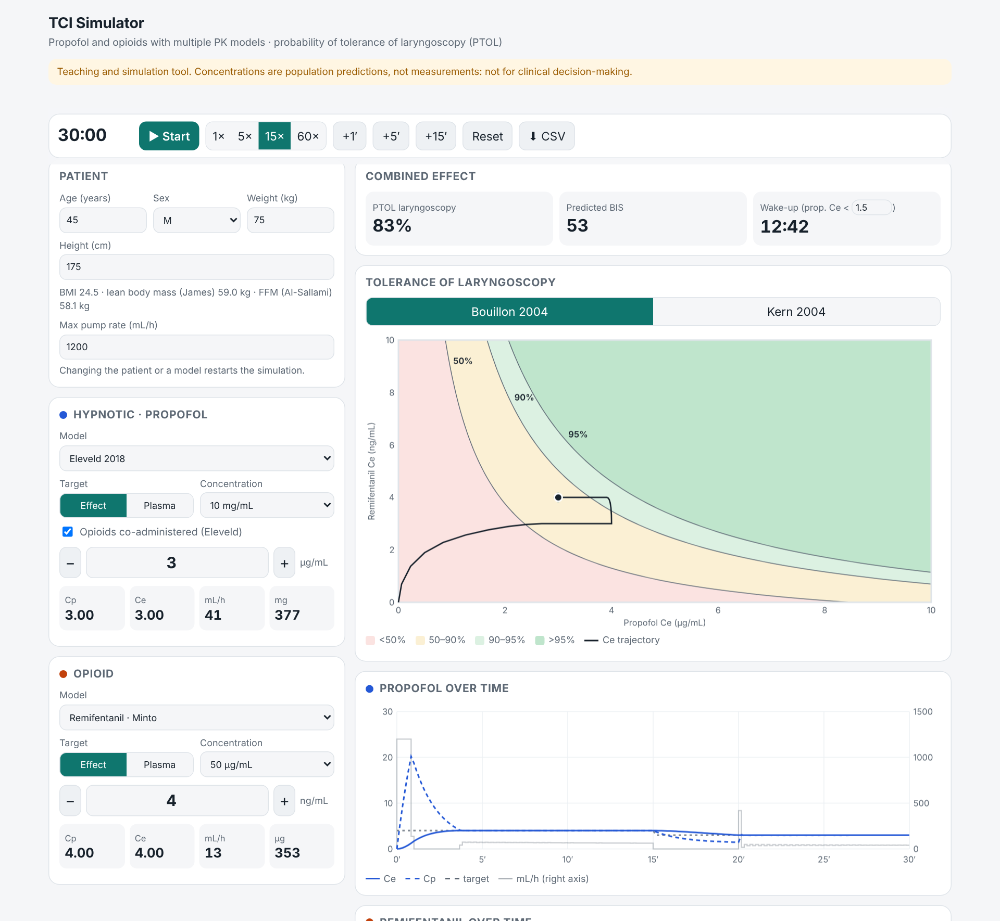

# TCI Simulator

 

A browser-based target-controlled infusion (TCI) simulator for propofol and opioids, with a live display of the probability of tolerance of laryngoscopy (PTOL).

**▶ Try it online: https://vonromans86.github.io/tci-simulator/** (no installation, works on phones)

**Teaching and simulation tool only.** Concentrations are population predictions, not measurements. Do not use for clinical decision-making.

## Features

- Effect-site or plasma targeting, adjustable while the simulation runs
- Simulation speed 1×–60× and time jumps (+1, +5, +15 min)
- Predicted Cp, Ce, infusion rate (mL/h) and cumulative dose for each drug
- Isobole plot of tolerance of laryngoscopy (50%, 90%, 95%) with the live Ce trajectory, using either the Bouillon or the Kern response surface
- Predicted BIS (Bouillon 2004 interaction model)
- Decrement time to a chosen propofol Ce (wake-up threshold)
- Table of the model parameters computed for the current patient
- CSV export of the whole simulation at 0.5-s resolution, saved as `YYYY-MM-DD.csv` (today's date)
- Warnings when a model is used outside its covariate range (age, BMI)

## Models

| Drug | Models |
| --- | --- |
| Propofol | Eleveld 2018, Schnider, Marsh, modified Marsh (ke0 1.2), Paedfusor, Kataria |
| Remifentanil | Minto, Eleveld 2017 |
| Fentanyl | Shafer 1990 (ke0 Scott–Stanski), Scott–Stanski 1987 |
| Sufentanil | Gepts |
| Alfentanil | Maitre |

## Algorithm

Three-compartment mammillary model with an effect compartment, solved exactly with a matrix exponential at 0.5-s steps. The infusion rate is updated every 2 s. In effect-site mode the rate at each update is the highest rate that keeps the predicted Ce at or below target over the next 20 minutes (a Shafer–Gregg-type approach), capped by the maximum pump rate. In plasma mode the rate brings the predicted Cp to target at the end of each 2-s interval.

## CSV export

The **⬇ CSV** button saves the simulation from time 0 to now, one row every 0.5 s, as `YYYY-MM-DD.csv`. Lines starting with `#` hold the patient, models, drug concentrations and pump limit; read the file with `pandas.read_csv(f, comment='#')` or `read.csv(f, comment.char = '#')` in R.

Columns, for each drug: target, mode (`ce`/`cp`), Cp, Ce, rate (mL/h and amount/min) and cumulative dose, with units in the column names; then `ptol_bouillon`, `ptol_kern` (empty unless the opioid is remifentanil) and `bis_bouillon`. Concentrations are at the end of each step; rates are those delivered during the preceding 0.5 s.

Changing the patient or a model restarts the simulation and clears the log, so export first.

## Interaction models

- **Bouillon 2004** (hierarchical model): Ce50 propofol 8.48 µg/mL, Ce50 remifentanil 1.16 ng/mL, γ 3.46, as tabulated by Hannivoort et al. and used by van den Berg et al. (J Clin Monit Comput 2021;35:815–25). The implementation reproduces their four PTOL 90% combinations (propofol/remifentanil 8.6/1, 5.9/2, 3.6/4, 2.0/8).
- **Kern 2004** (Greco model): C50 propofol 5.6 µg/mL, C50 remifentanil 48.9 ng/mL, slope 2.2, α 33.2.

Both surfaces were estimated with Schnider (propofol) and Minto (remifentanil) concentrations. With other PK models the Ce values are not directly equivalent.

## References

- Marsh B et al. Br J Anaesth 1991;67:41–8. Struys MMRF et al. Anesthesiology 2000;92:399–406.
- Schnider TW et al. Anesthesiology 1998;88:1170–82; 1999;90:1502–16.
- Eleveld DJ et al. Br J Anaesth 2018;120:942–59.
- Absalom A et al. Br J Anaesth 2003;91:507–13 (Paedfusor). Kataria BK et al. Anesthesiology 1994;80:104–22. Muñoz HR et al. Anesthesiology 2004;101:1269–74 (paediatric ke0).
- Minto CF et al. Anesthesiology 1997;86:10–23. Eleveld DJ et al. Anesthesiology 2017;126:1005–18.
- Shafer SL et al. Anesthesiology 1990;73:1091–102. Scott JC, Stanski DR. J Pharmacol Exp Ther 1987;240:159–66 (fentanyl, ke0 0.147/min).
- Gepts E et al. Anesthesiology 1995;83:1194–204. Maitre PO et al. Anesthesiology 1987;66:3–12.
- Bouillon TW et al. Anesthesiology 2004;100:1353–72. Kern SE et al. Anesthesiology 2004;100:1373–81.

Propofol (Schnider, Marsh, Eleveld) and remifentanil (Minto, Eleveld) parameters were cross-checked against the open-source Python Anesthesia Simulator (Aubouin-Pairault et al., JOSS 2023).

## How to cite

Romanelli A. *TCI Simulator: multi-model target-controlled infusion simulator with tolerance-of-laryngoscopy isoboles* (v1.0.0). Zenodo; 2026. https://doi.org/10.5281/zenodo.24058642

GitHub's **Cite this repository** button gives the same reference in APA and BibTeX.

## Usage

Open `index.html` in any modern browser. No installation or dependencies.
